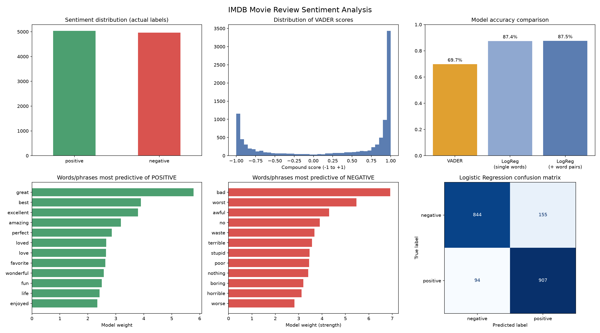

# Sentiment Analysis of IMDB Movie Reviews

I built this for Week 3 of my AI bootcamp, where the task was to create a sentiment analysis tool. I wanted to find out how well a computer can tell whether a movie review is positive or negative, so I tried two different approaches on 10,000 real IMDB reviews and checked each one against the labels in the dataset.

The first approach is VADER, a ready-made tool that scores text using a dictionary of words. The second is a machine learning model that I trained on labeled reviews. I compared how often each one gets it right, then looked at which words give a review away as positive or negative.

**Author:** Matsatsi Mabala
**Tools:** Python, pandas, scikit-learn, VADER, matplotlib, SciPy, Streamlit



## Web app

The project also runs as a web app. Upload a CSV, TSV, Excel or JSON file and the app analyses it automatically:

- **Overview:** rows, columns, missing values, duplicates, and a plain-English list of what stands out (strong correlations, outliers, skewed or mostly empty columns).
- **Columns:** every column's detected type (numeric, category, date, text or identifier), with a way to correct it if the guess is wrong.
- **Numbers, Categories, Dates:** distributions, outliers, correlation heatmap, most common values and trends over time.
- **Relationships:** pick any two columns and get a suitable chart plus a statistic (correlation, group comparison or chi-square test).
- **Text sentiment:** scores any text column with VADER. If the data has a label column, it also trains the model from this project and compares it with VADER on the same held-out rows, shows the most predictive words and where the model is confidently wrong, and lets you try your own text. Sentiment can be broken down by category or over time.
- **Export:** cleaned data, column summary and sentiment results as CSV.

Click **Try sample data** in the sidebar to explore it without a file.

### Run it locally

```bash
pip install -r requirements.txt
streamlit run app.py
```

### Deploy it

The simplest route is [Streamlit Community Cloud](https://streamlit.io/cloud) (free):

1. Push this repository to GitHub.
2. Sign in at share.streamlit.io, choose **Create app**, select the repository and set the main file to `app.py`.
3. Deploy. Dependencies are installed from `requirements.txt` and the upload limit comes from `.streamlit/config.toml`.

Other hosts that run a Python web process (Render, Railway, a Docker container on any server) work too, with the start command `streamlit run app.py --server.port $PORT --server.address 0.0.0.0`.

Things to know before sharing it publicly:

- Uploaded files are processed in memory and not saved by the app, but a public URL means anyone can use it. Don't upload sensitive data to a public deployment, and add authentication if you need to restrict access.
- Free hosting has limited memory. Files over 250,000 rows are sampled automatically, and sentiment analysis uses at most 50,000 rows (10,000 by default) so it stays responsive.

### Project structure

| File | Purpose |
|---|---|
| `app.py` | The Streamlit web app |
| `sentiment_analysis.py` | VADER scoring, model training and sentiment charts. Also the original command-line script for the IMDB dataset |
| `tabular_analysis.py` | Column type detection, profiling, outliers, correlations, insights and charts for any dataset |
| `plotting.py` | Shared chart colours and style (navy and gold) |
| `style.css` | The app's look: header, tabs, cards and buttons. The theme colours are in `.streamlit/config.toml` |
| `demo_data.py` | Small synthetic dataset for the "Try sample data" button |
| `tests/` | Tests for the analysis code (`pip install pytest`, then `pytest`) |

## Overview

Two approaches are compared:

1. **VADER**, a ready-made, rule-based sentiment tool that needs no training.
2. **Logistic regression on TF-IDF features**, a machine learning classifier trained on labeled reviews.

Both are evaluated against the sentiment labels in the dataset, so accuracy can be measured rather than assumed.

## Results

| Model | Accuracy | Evaluated on |
|---|---|---|
| VADER | 69.7% | All 10,000 reviews |
| Logistic regression (single words) | 87.3% | 2,000 held-out test reviews |
| Logistic regression (words + word pairs) | 87.5% | 2,000 held-out test reviews |

Confusion matrix for the final model (test set):

| | Predicted negative | Predicted positive |
|---|---|---|
| **Actually negative** | 842 | 157 |
| **Actually positive** | 94 | 907 |

### Key findings

- **A model trained on movie reviews beat a general-purpose tool** by about 18 percentage points. VADER was designed for short social media text, while movie reviews are long and often mix praise with criticism.
- **The most frequent words were not the most meaningful.** Words like "good", "time" and "story" appear heavily in both positive and negative reviews. The model's learned weights gave a far clearer picture: *great, best, excellent, amazing, perfect* for positive and *bad, worst, awful, waste, terrible* for negative.
- **Adding two-word phrases made almost no difference** (+0.2 percentage points, roughly 4 reviews out of 2,000), which is within the range of chance. Single words already capture most of the signal in this dataset.
- **The model makes more mistakes on negative reviews** (157 predicted positive) than on positive ones (94 predicted negative).

## Dataset

[IMDB Dataset of 50K Movie Reviews](https://www.kaggle.com/datasets/lakshmi25npathi/imdb-dataset-of-50k-movie-reviews) from Kaggle. Each row has a `review` (text) and a `sentiment` (positive or negative). This project uses a random sample of 10,000 reviews (5,039 positive, 4,961 negative) to keep run times short. Change `SAMPLE_SIZE` in the script to use more.

The dataset is not included in this repository. Download it from Kaggle and place `IMDB Dataset.csv` in the project folder.

## How to run the original IMDB analysis (command line)

```bash
pip install -r requirements.txt
python sentiment_analysis.py
```

Outputs:

- `sentiment_dashboard.png`: six-panel dashboard of the results
- `results.csv`: every review with its VADER score and label
- Accuracy scores, a classification report and the top words printed to the terminal

## Technical explanation

### 1. Cleaning
HTML tags (such as `<br />`) and extra whitespace are removed using regular expressions. Text is otherwise left intact, because VADER relies on punctuation and capitalization.

### 2. VADER
VADER scores each review with a compound value from -1 (very negative) to +1 (very positive). Scores of 0 or above are labeled positive, and the rest negative. There is no neutral class, since the dataset labels are binary.

### 3. TF-IDF and logistic regression
- **TF-IDF** converts each review into a numeric vector. Words that are common across many reviews are down-weighted, and words that are distinctive to a review are up-weighted.
- **Logistic regression** learns a weight for each word. A large positive weight pushes a review toward "positive" and a large negative weight toward "negative". These weights are what the "most predictive words" charts show.
- The data is split 80/20 into training and test sets, so accuracy is measured on reviews the model has never seen.

### 4. Word pairs experiment
To test whether the model could capture negation (for example "not good"), a second version also uses two-word phrases. Standard stop-word lists remove words like "not", "no" and "never", so these were deliberately kept for this version. The experiment produced only a small improvement.

## Limitations

- Only 10,000 of the 50,000 available reviews were used, and results come from a single train/test split.
- In the command-line results above, VADER was scored on all 10,000 reviews while the ML models were scored on a 2,000-review test set, so that comparison is indicative rather than exact. The web app scores both on the same held-out rows.
- Labels are binary, so mixed or neutral reviews are forced into one class.

Web app specific:

- Column types are detected with rules of thumb, so an unusual column can be misjudged. Use the override in the Columns tab.
- Dates such as 03/04/2024 can be read as 3 April or 4 March. The app works out the order when any date has a day above 12. Otherwise it reads them as month/day and shows a sidebar option to switch.
- VADER is built for English text. For other languages, use the label-based model, which learns from your own data.
- The model is trained fresh on each run, on up to 50,000 rows, with a single 80/20 split.
- The models treat text as a bag of words and cannot understand sarcasm or context.

## Possible next steps

- Use the full dataset with cross-validation for more reliable estimates.
- Try a pretrained transformer model (for example from Hugging Face) that handles context and negation better.
- Read a sample of misclassified reviews to understand where the models fail.
- Add a neutral category.
